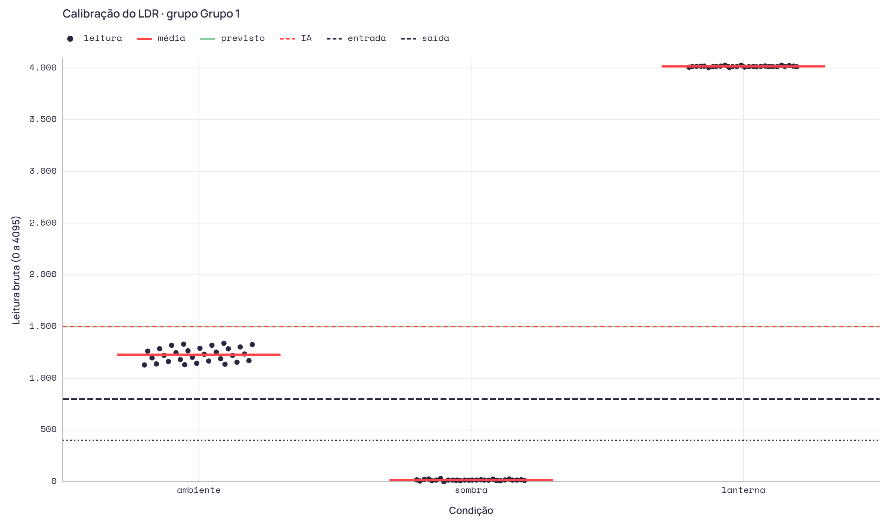

# Relatório · Atividade ponderada de Computação 2 - Semáforo com dois modos de operação

**Grupo:** Grupo 1 · **Turma:** T24
**Integrantes:** Luiz, Arthur, Heloisa, Bruno, Guilherme, Rachel, Pablo Marchina
**Previsão registrada em:** 08/11/2026, 20:08:59
**Primeira leitura importada em:** 08/11/2026, 20:12:07 · previsão registrada antes da primeira leitura

## 1. Contextualizar

| Item | Valor |
|---|---|
| Transições espúrias toleráveis por minuto | 0 |
| Limiar previsto (0 a 4095) | 1500 |

- **Por que esse número de transições:** Um semáforo que alterna entre o modo diurno e o amarelo piscante confunde o motorista: ele não sabe se deve parar ou seguir, e isso gera risco de acidente. Por isso, com a luz passando devagar pelo limiar, o grupo aceita só a troca real de modo (uma ao escurecer e uma ao clarear) e nenhuma troca a mais. Mais de uma troca no mesmo sentido já conta como falha.
- **Origem do limiar previsto:** Do divisor de tensão pensado inicialmente, com LDR no 3V3 e 10 kΩ no GND. A página recomenda um resistor fixo que deixe a luz ambiente perto do meio da escala (~2048). Como a leitura sobe com a luz, o escuro deveria ficar abaixo do meio, e escolhemos 1500 como ponto de entrada no modo noturno, com uma margem abaixo do valor esperado para a sala. A previsão foi registrada depois da medição na bancada, mas sem usar os valores medidos.
- **O que o grupo delega à IA:** Pedir uma estratégia para evitar oscilação perto de um limiar, sem pedir código, e conferir a explicação da técnica. Os limiares, a tabela de calibração e a montagem saem das medições do grupo. O código e a documentação tiveram apoio de IA, revisado pelo grupo.

## 2. Consultar

- **Ferramenta:** Claude
- **Pergunta:** Tenho um semáforo com ESP32 que deve entrar em modo noturno quando um sensor de luz LDR, lido pelo conversor analógico de 0 a 4095, indicar pouca luz. Perto do limiar, a leitura tem ruído e o semáforo fica alternando entre os modos. Como evitar essa oscilação? Que valor de limiar você usaria? Não quero código, só a estratégia.
- **Estratégia sugerida:** A técnica certa aqui é a histerese: usar dois limiares em vez de um. O problema: com um limiar só, quando a luz fica perto dele, o ruído da leitura passa para cima e para baixo várias vezes por segundo. Cada passagem troca o modo, e o semáforo fica “piscando” entre diurno e noturno. A estratégia: Dois limiares separados por uma faixa morta. Um limiar de entrada liga o modo noturno quando a luz cai abaixo dele. Outro, de saída, fica num ponto mais claro e só desliga o modo noturno quando a luz sobe acima dele. Entre os dois, o sistema mantém o modo em que está. O termostato e o gatilho Schmitt da eletrônica funcionam assim. A faixa entre os limiares precisa ser maior que o ruído. Meça quanto a leitura varia com a luz parada, sem mexer em nada. A distância entre os dois limiares tem que ser claramente maior que essa variação, por exemplo umas 3 vezes o desvio padrão. Se a faixa for menor que o ruído, a oscilação volta. Opcionais, que ajudam junto com a histerese: Média de várias leituras (média móvel) antes de comparar, para reduzir o ruído. Confirmação por tempo: só trocar de modo se a condição se mantiver por alguns segundos. Isso evita que uma sombra passageira, como uma pessoa ou um carro passando, troque o modo.
- **Nome da técnica:** Histerese (dois limiares, como o gatilho Schmitt)
- **Limiar sugerido pela IA:** 1500

## 3. Confrontar: tabela de calibração

Leitura bruta do conversor de 12 bits (0 a 4095).

| Condição | n | Mínimo | Máximo | Média | Desvio |
|---|---|---|---|---|---|
| ambiente | 30 | 1.129 | 1.338 | 1.228,1 | 67,7 |
| sombra | 30 | 0 | 31 | 16,1 | 6,1 |
| lanterna | 30 | 4.004 | 4.027 | 4.015,3 | 5,6 |

- **Sentido:** a leitura sobe com a luz
- **Maior ruído numa mesma condição:** 209 contagens

Verificações:
- OK: ambiente iluminado: 30 leituras, de 1.129 a 1.338.
- OK: sombreado pela mão: 30 leituras, de 0 a 31.
- OK: lanterna: 30 leituras, de 4.004 a 4.027.
- OK: Sentido detectado: a leitura sobe com a luz (lanterna acima da sombra).
- OK: Região entre as faixas: leituras de 31 a 1.129. Maior ruído numa mesma condição: 209 contagens.
- Atenção: Limiar previsto (1.500) fica além da faixa de ambiente, do lado da lanterna, e o modo noturno entraria com a sala iluminada.
- Atenção: Limiar sugerido pela IA (1.500) fica além da faixa de ambiente, do lado da lanterna, e o modo noturno entraria com a sala iluminada.

**Divergência explicada:** O limiar previsto (1500) e o sugerido pela IA (1500 para entrar e 2000 para sair do modo noturno) ficaram acima de toda a faixa medida na luz ambiente (1129 a 1338). O 1500 está 162 contagens acima do maior valor do ambiente e 272 acima da média (1228). Com qualquer um dos dois, o semáforo entraria em modo noturno com a sala iluminada. A saída sugerida pela IA (2000) nem seria alcançada com a luz da sala, então o modo noturno não sairia mais. A divergência vem de uma suposição comum à previsão e à IA: as duas consideraram que a luz ambiente ficaria perto do meio da escala (~2048). Isso não aconteceu. Com o resistor fixo de 10 kΩ, a sala lia 0 e não se distinguia da sombra, porque a resistência do LDR na luz da sala é muito maior que 10 kΩ. Trocamos por 47 kΩ, e o ambiente passou a ~1228, abaixo do meio da escala, enquanto a sombra ficou em ~16 e a lanterna em ~4015. Por isso os limiares finais saíram das medições e não da previsão nem da IA. A entrada ficou em 400, bem acima do máximo da sombra (31). A saída ficou em 800, abaixo do mínimo do ambiente (1129). A folga de 400 é maior que o maior ruído medido numa mesma condição (209 contagens no ambiente). Da sugestão da IA, aproveitamos a técnica (histerese) e rejeitamos os valores.



<details><summary>Leituras brutas (90)</summary>

```csv
condicao,leitura
sombra,18
sombra,16
sombra,13
sombra,26
sombra,15
sombra,26
sombra,31
sombra,19
sombra,19
sombra,16
sombra,25
sombra,23
sombra,16
sombra,17
sombra,16
sombra,16
sombra,16
sombra,16
sombra,15
sombra,7
sombra,10
sombra,9
sombra,10
sombra,16
sombra,16
sombra,0
sombra,16
sombra,13
sombra,14
sombra,13
ambiente,1129
ambiente,1131
ambiente,1136
ambiente,1139
ambiente,1145
ambiente,1155
ambiente,1162
ambiente,1167
ambiente,1171
ambiente,1181
ambiente,1189
ambiente,1198
ambiente,1203
ambiente,1222
ambiente,1222
ambiente,1232
ambiente,1235
ambiente,1248
ambiente,1253
ambiente,1263
ambiente,1266
ambiente,1285
ambiente,1286
ambiente,1290
ambiente,1303
ambiente,1319
ambiente,1319
ambiente,1326
ambiente,1330
ambiente,1338
lanterna,4007
lanterna,4005
lanterna,4016
lanterna,4017
lanterna,4027
lanterna,4027
lanterna,4013
lanterna,4015
lanterna,4018
lanterna,4027
lanterna,4019
lanterna,4016
lanterna,4014
lanterna,4013
lanterna,4004
lanterna,4013
lanterna,4023
lanterna,4018
lanterna,4016
lanterna,4014
lanterna,4014
lanterna,4014
lanterna,4018
lanterna,4009
lanterna,4016
lanterna,4015
lanterna,4012
lanterna,4012
lanterna,4015
lanterna,4012
```

</details>

## 4. Construir

| Item | Valor |
|---|---|
| Limiar de entrada no modo noturno | 400 |
| Limiar de saída do modo noturno | 800 |
| Folga entre os limiares | 400 contagens |
| Plano do RA (vermelho, verde, amarelo) | 11 s, 6 s, 2 s (dígito 6) |

Verificações:
- OK: Ordem coerente com o sentido: entrada do lado escuro, saída do lado claro.
- OK: Limiar de entrada (400) fica entre a faixa de sombra e a de ambiente.
- OK: Limiar de saída (800) fica entre a faixa de sombra e a de ambiente.
- OK: Folga de 400 contagens, maior que o ruído medido de 209.

**Como os limiares saíram das medições:** Neste divisor a leitura sobe com a luz. Sombra: 0 a 31 (média 16,1). Ambiente: 1129 a 1338 (média 1228,1; faixa de ruído de 209). Lanterna: 4004 a 4027. O modo noturno entra quando a leitura cai abaixo de 400 e sai quando passa de 800. A folga entre os dois é de 400, maior que a maior variação medida numa mesma condição (209 no ambiente). Entrada 400: fica 369 acima do máximo da sombra e 729 abaixo do mínimo do ambiente. Saída 800: fica 329 abaixo do mínimo do ambiente, então a volta da luz da sala sempre tira o semáforo do modo noturno; e fica 769 acima do máximo da sombra, então o ruído no escuro não desliga o modo noturno por engano.

**Montagem:** o divisor de tensão tem o LDR entre o 3V3 e o nó e um resistor fixo de 47 kΩ entre o nó e o GND. O nó vai ao GPIO34 (ADC1). Como o LDR fica do lado do 3V3, a leitura sobe com a luz. Com o resistor de 10 kΩ, a sala lia 0 e não se distinguia da sombra, por isso ele foi trocado. A posição de cada peça na protoboard está em [MONTAGEM.md](MONTAGEM.md). A saída bruta da calibração está em [calibracao_ldr/saida-monitor-serial.txt](calibracao_ldr/saida-monitor-serial.txt).

**Implementação** (`semaforo/semaforo.ino`): o modo diurno roda o ciclo vermelho → verde → amarelo com os tempos do plano do RA. O LDR é lido a cada 200 ms sem travar o ciclo, porque o código usa `millis()` em vez de `delay()`. O modo noturno deixa o amarelo piscando a 1 Hz. Ele entra quando a leitura cai abaixo de 400 e só sai quando ela passa de 800; entre os dois limiares, o modo atual se mantém. Na volta ao modo diurno, o ciclo reinicia pelo vermelho. Cada troca de modo é impressa no Serial como `# troca de modo #N`.

## 5. Comprovar

- **Vídeo:** https://youtube.com/shorts/3qd2LRfXiK0
- **Trocas de modo observadas:** 2 (critério declarado: 0 por minuto)
- **Por que a histerese impede a oscilação:** Depois que o modo noturno entra, a leitura precisa subir até o limiar de saída para voltar ao diurno, e como a distância entre os dois limiares (400) é maior que o ruído medido (209), o ruído sozinho não consegue provocar uma nova troca. No vídeo houve 2 trocas, as duas reais (uma ao escurecer e uma ao clarear), e nenhuma espúria, dentro do critério de 0 declarado no Contextualizar.

ADR individual em `ADR.md`, autor: Luiz.
